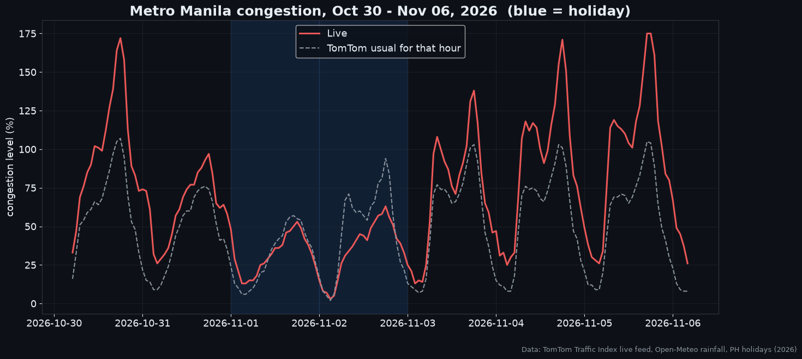
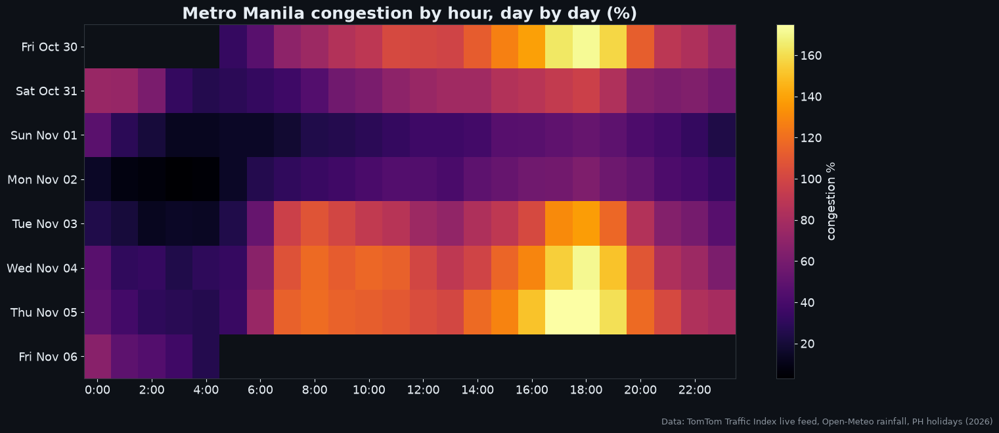
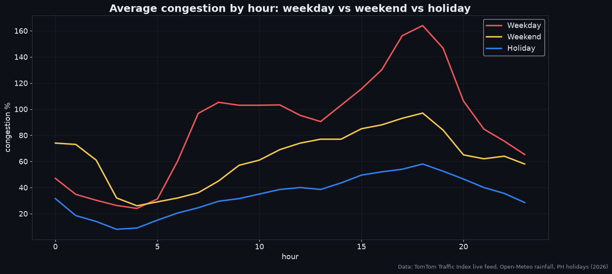
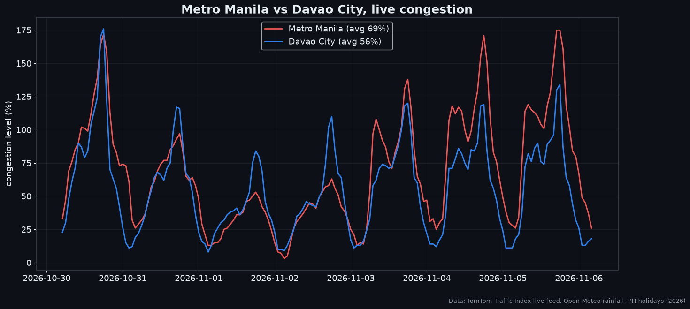
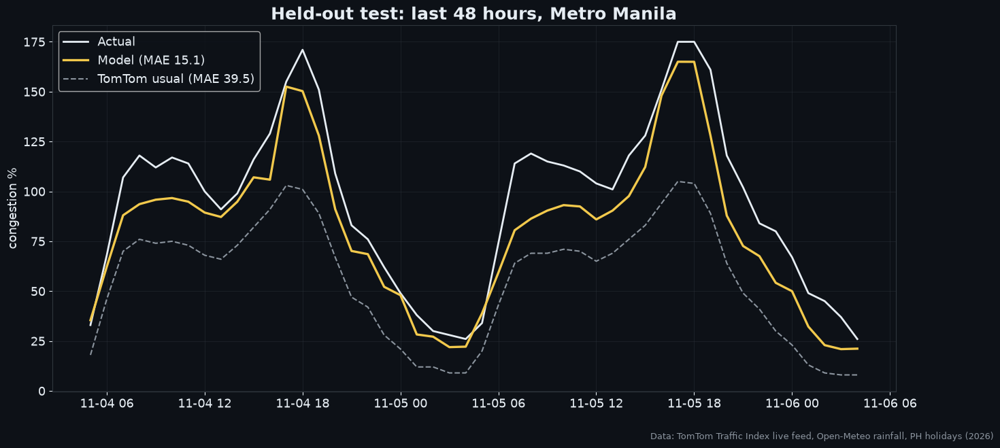
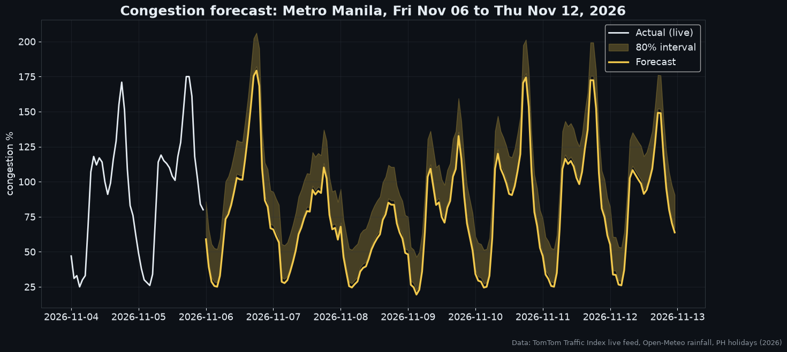

# 🚦 Metro Manila Traffic Forecaster (2026, live)

A self-contained machine-learning project built on **real 2026 traffic data**. It tracks Metro Manila congestion hour by hour and forecasts any future days or weeks on its own.



## Data: real, current, no API keys

| Dataset | What | Source |
|---|---|---|
| **Live hourly congestion**: congestion %, usual-for-this-hour, jam count / length / delay | Metro Manila and Davao City. **Oct 30 to Nov 6, 2026**, bundled in the repo | [TomTom Traffic Index](https://www.tomtom.com/traffic-index/city/manila/) live feed |
| **Rainfall**: observed and 3-day forecast, hourly | Metro Manila and Davao City | [Open-Meteo](https://open-meteo.com) |
| **Holidays** | 2026 regular and special non-working days | [`holidays`](https://pypi.org/project/holidays/) (Proclamation 1006, 2025) |

The data snapshot is bundled in [`live/`](live/), so the model trains and runs **offline, with no API keys and no scheduled jobs**. To pull newer hours whenever you want, run `python run.py --refresh` or click **Refresh data** in the dashboard. Both use the public feed, with no key.

*Congestion % is the extra travel time compared with free-flowing traffic. 100% means a trip takes twice as long.*

## Key findings (Oct 30 – Nov 6, 2026)
- **Metro Manila traffic ran 41% above TomTom's "usual"** for the same hours.
- **Weekday 6 PM is the worst hour, averaging 164% congestion**, which means trips took about 2.6× as long. The peak was **175%**.
- **Nov 5 at 5 PM had 348 simultaneous jams totalling 284 km.**
- **The Undas long weekend (Nov 1–2) was the only stretch below usual**: congestion on Nov 2 averaged 36% against a usual 48%.
- **Metro Manila is more congested than Davao City**: 69% vs 56% average.

| | |
|---|---|
|  |  |
|  |  |

## Model: forecast any day, on its own
Run it and it predicts **from today forward**, for as many days or weeks as you ask. No new traffic data is needed:

```bash
python run.py                              # next 7 days from today
python run.py --days 30                    # next 30 days
python run.py --start 2026-12-20 --days 14 # Christmas rush
python run.py --city "Davao City"
```
It prints a day-by-day table (average congestion, peak, peak hour, holiday, rain) and saves every hour to `forecast.csv`.

**How it works**
- **Base:** TomTom's "usual" congestion for each weekday and hour, learned from the bundled data. TomTom builds this from its long-term driver history, so it captures a normal week.
- **The model:** scikit-learn HistGradientBoosting learns how much traffic rises or falls above that baseline. Its inputs are:
  - hour of day
  - weekend or not
  - **official PH holidays for any year**, from the `holidays` package
  - rainfall in the current hour and the last 3 hours
  - city
- **Rain for future dates:**
  - **Up to 16 days ahead, if online:** the live Open-Meteo forecast.
  - **Otherwise:** assumed dry.

**Accuracy:** the model was tested on the last 48 hours of real data, which were held out from training.

| Held out: Nov 4–6, 2026 | MAE (congestion points) |
|---|---|
| TomTom "usual for this hour" | 39.5 |
| **This model** | **15.1** |

That's **62% lower error** than TomTom's typical-traffic estimate.




**What the forecast can't capture yet:** it knows weekday rush hours, holidays and rain. It doesn't yet know seasonal trends such as the December rush, because the bundled data covers one week. Each `--refresh` adds new weeks, and the model retrains on everything it has.
## 📅 Live dashboard
```bash
pip install -r requirements.txt
streamlit run app.py
```
The dashboard has three tabs:
- **This month (live):** current congestion vs usual, jams, and Manila vs Davao.
- **Forecast:** pick a start date, 1–30 days and a city to get a day-by-day table and the worst hours.
- **Patterns:** weekday vs weekend vs holiday, congestion by day, and rain vs extra congestion.

## Rebuild
```bash
python run.py             # trains on the bundled data, forecasts 7 days from today, writes assets/
python run.py --refresh   # optional: pull the newest public data first
```

## Tech
Python · pandas · scikit-learn · matplotlib · Streamlit
