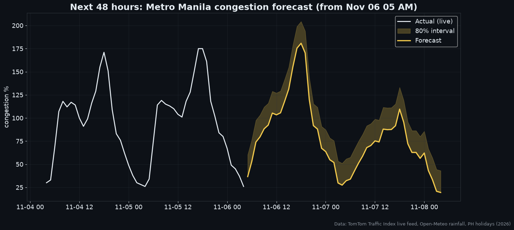

# 🚦 Metro Manila Traffic Forecaster (2026, live)

A machine-learning project built on **real 2026 traffic data**, collected live every 6 hours. It tracks Metro Manila congestion hour by hour and forecasts the next 48 hours.


## Data: real, current, no API keys

| Dataset | What | Source |
|---|---|---|
| **Live hourly congestion**: congestion %, usual-for-this-hour, jam count / length / delay | Metro Manila and Davao City. **Collected so far: Oct 30 to Nov 6, 2026**, with new hours added every 6 hours | [TomTom Traffic Index](https://www.tomtom.com/traffic-index/city/manila/) live feed |
| **Rainfall**: observed and 3-day forecast, hourly | Metro Manila and Davao City | [Open-Meteo](https://open-meteo.com) |
| **Holidays** | 2026 regular and special non-working days | [`holidays`](https://pypi.org/project/holidays/) (Proclamation 1006, 2025) |

The data lives in [`live/manila_hourly.csv`](live/manila_hourly.csv). The GitHub Action [`collect.yml`](.github/workflows/collect.yml) pulls the TomTom feed every 6 hours and commits new rows, so the dataset keeps growing on its own.

*Congestion % is the extra travel time compared with free-flowing traffic. 100% means a trip takes twice as long.*

## Key findings (Oct 30 – Nov 6, 2026)
- **Metro Manila traffic ran 41% above TomTom's "usual"** for the same hours.
- **Weekday 6 PM is the worst hour, averaging 164% congestion**, which means trips took about 2.6× as long. The peak was **175%**.
- **Nov 5 at 5 PM had 348 simultaneous jams totalling 284 km.**
- **The Undas long weekend (Nov 1–2) was the only stretch below usual**: congestion on Nov 2 averaged 36% against a usual 48%.
- **Metro Manila is more congested than Davao City**: 69% vs 56% average.

| | |
|---|---|
|  |  |
|  |  |

## Model: 48-hour congestion forecast
- **Target:** Metro Manila congestion %, hourly.
- **Features:** hour, weekday, city, TomTom usual-for-this-hour, rainfall (this hour and the last 3 hours), holiday.
- **Algorithm:** scikit-learn HistGradientBoosting, trained on both cities.
- **Test:** the most recent 48 hours of Metro Manila data, held out from training.

| Last 48 h (Nov 4–6, 2026) | MAE (congestion points) |
|---|---|
| TomTom "usual for this hour" | 39.5 |
| **This model** | **11.9** |

That's **70% lower error** than TomTom's own typical-traffic estimate. The model is retrained on every run, so it improves as more weeks are collected.




## 📅 Live dashboard
```bash
pip install -r requirements.txt
streamlit run app.py
```
The dashboard has three tabs:
- **This month (live):** current congestion vs usual, jams, and Manila vs Davao.
- **Next 48 h:** the forecast and the worst hours ahead.
- **Patterns:** weekday vs weekend vs holiday, congestion by day, and rain vs extra congestion.

## Rebuild
```bash
python run.py   # pulls the latest data, retrains, regenerates assets/ and results.json
```

## Tech
Python · pandas · scikit-learn · matplotlib · Streamlit · GitHub Actions
