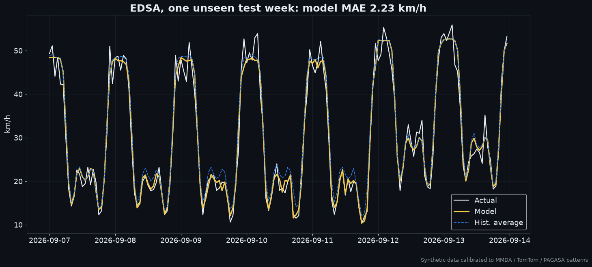
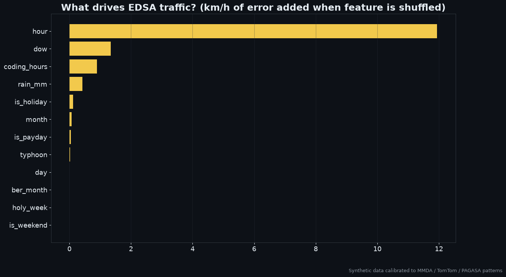
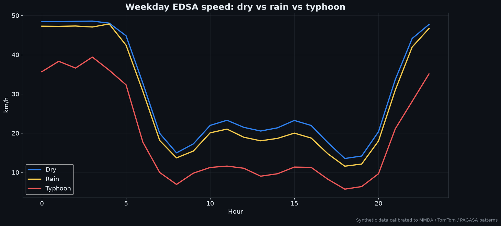
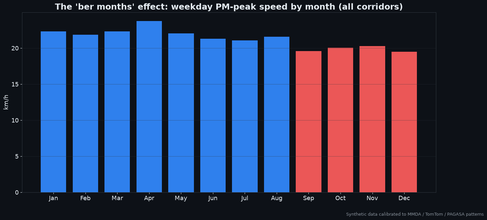
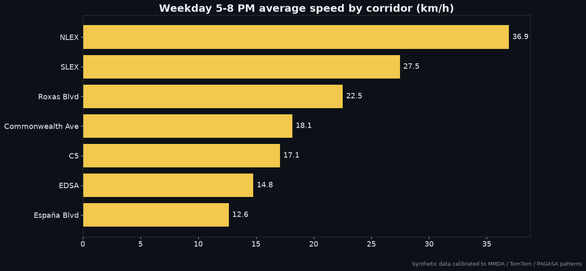

# 🚦 Metro Manila Traffic Forecaster

An ML project that predicts **hourly travel speed** on 7 Metro Manila corridors (EDSA, C5, Commonwealth, España, Roxas Blvd, SLEX, NLEX) and explains the main causes of congestion: rush hour, rain and typhoons, payday, the "ber months", and holidays.


## Results (test set: May–Oct 2026, never seen in training)

| Model | MAE (km/h) | RMSE | R² |
|---|---|---|---|
| Historical hour × weekday average | 2.66 | 3.56 | 0.961 |
| **Gradient boosting (this project)** | **2.23** | **2.99** | **0.972** |

**16% lower error** than the baseline, mostly on rainy days, typhoon days and holidays, which a plain average can't anticipate.

## Visuals

| | |
|---|---|
|  |  |
|  |  |
|  |  |

## Features the model uses
- **Time:** hour, weekday, month, day of month
- **PH calendar:** regular/special holidays, Holy Week, payday (15th and end of month), "ber months" (Sep–Dec)
- **Policy:** MMDA UVVRP number-coding windows (7–10 AM, 5–8 PM)
- **Weather:** hourly rainfall (mm), typhoon days (PAGASA-style)
- **Road:** corridor ID

## ⚠️ About the data
No free, hourly, multi-year speed dataset exists for Metro Manila, so this repo **generates synthetic data calibrated to published figures**. The generator's parameters were grid-searched until EDSA matched these targets:

| Calibration target | Published figure | This dataset |
|---|---|---|
| EDSA weekday average speed (6 AM–10 PM) | ~21 km/h ([MMDA via Philstar, Dec 2024](https://www.philstar.com/nation/2024/12/07/2405550/mmda-car-volume-along-edsa-surpass-record)) | 20.7 km/h |
| Rush-hour speed, Manila | 15.2 km/h ([TomTom Traffic Index 2025](https://www.tomtom.com/traffic-index/city/manila/), [Manila Bulletin](https://mb.com.ph/2026/01/22/davao-city-remains-most-traffic-congested-city-in-ph-tomtom-traffic-index)) | 14.6 km/h |
| December holiday rush | Volume +10–20%, speed could fall to ~15 km/h ([MMDA via Manila Bulletin, Dec 2025](https://mb.com.ph/2025/12/12/edsa-traffic-hits-holiday-peak-with-434k-vehicles-mmda)) | PM peak 12.5 km/h |
| Oil-price dip, Mar 2026 | EDSA volume −5–7% ([BusinessMirror](https://businessmirror.com.ph/2026/03/24/mmda-reports-5-to-7-drop-in-edsa-traffic-volume-as-me-tensions-spur-oil-prices/)) | −6% demand |

Other references:
- EDSA carried 407,342 vehicles/day in the MMDA AADT 2023 report ([Top Gear PH](https://www.topgear.com.ph/features/feature-articles/mmda-aadt-report-2023-a2619-20240522)) and 434k/day at the December 2025 peak.
- In TomTom 2025, a 10 km drive took 31m45s in the city center and 28m02s across the metro area ([Rappler](https://www.rappler.com/philippines/metro-manila-davao-city-traffic-index-data-2025/)).
- Holidays come from the actual proclamations for 2023–2026, including Proc. 1006 (2025) for 2026 ([LawPhil](https://lawphil.net/executive/proc/proc2025/proc_1006_2025.html)). Holy Week dates are exact.
- Weather follows PAGASA climatology: wet season Jun–Nov and typhoon peak Jul–Nov. The rain and typhoon days themselves are simulated, not historical.

To use real data, export it to a CSV with columns `timestamp, road, speed_kph, rain_mm, typhoon` and call `src.data.load_real(path)`. Possible sources are the TomTom/HERE/Google Routes APIs, MMDA open data, or your own GPS logs. The rest of the pipeline stays the same.

## Run it
```bash
pip install -r requirements.txt
python run.py
```
Charts are written to `assets/` and metrics to `results.json`. The run takes about 1 minute on a laptop.

## Project structure
```
src/data.py   # synthetic generator + real-data loader + PH calendar features
run.py        # train, evaluate, and render all charts
PROMPT.md     # the master prompt used to build this project
```

## Next steps
- Connect live TomTom / Google Routes data
- Add PAGASA live rainfall forecasts for weather-aware predictions
- Add a Streamlit dashboard with a route-and-time picker
- Use LSTM / Temporal Fusion Transformer models for multi-step forecasting

## Tech
Python · pandas · scikit-learn (HistGradientBoosting) · matplotlib
