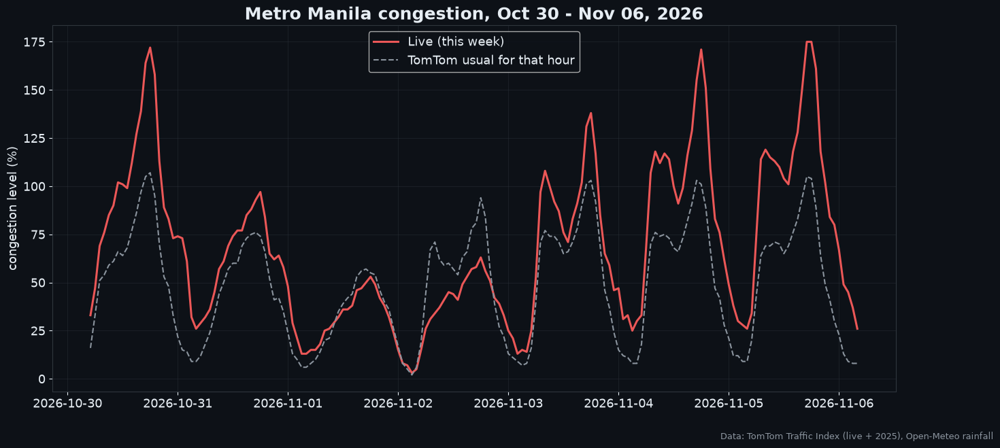
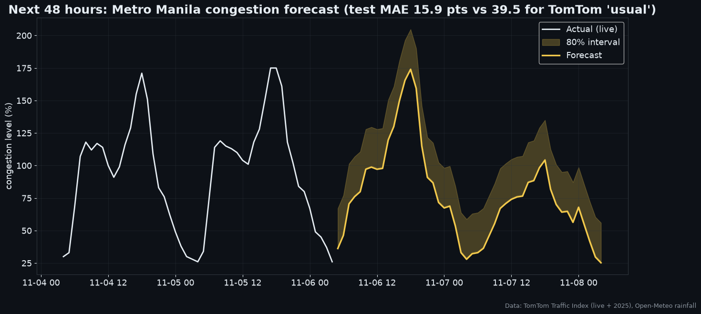
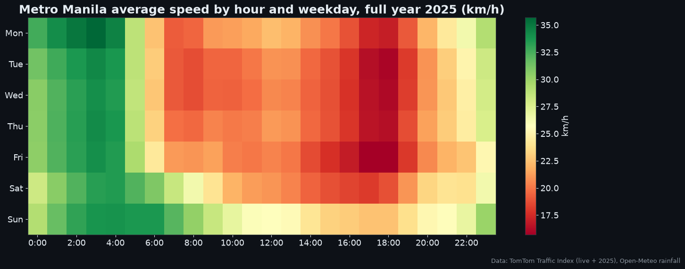
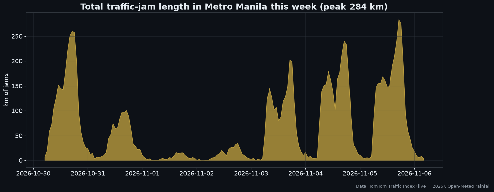

# 🚦 Metro Manila Traffic Forecaster

A machine-learning project built on **100% real data, updated every 6 hours**. It tracks and forecasts Metro Manila congestion using TomTom's live traffic feed, and explains where, when and why road incidents happen using 17,000 MMDA incident alerts.



## Data (all real, all public, no API keys)

| Dataset | Coverage | Source |
|---|---|---|
| **Live hourly congestion**: congestion %, usual-for-this-hour, jam count / length / delay | Metro Manila and Davao City, **refreshed every 6 h**, saved to [`live/manila_hourly.csv`](live/manila_hourly.csv) | [TomTom Traffic Index](https://www.tomtom.com/traffic-index/city/manila/) live feed |
| **2025 traffic profile**: speed and congestion for each of the 168 hours of the week, monthly figures, worst day | Full year 2025, from billions of anonymised driver trips | [TomTom Traffic Index 2025](https://www.tomtom.com/traffic-index/city/manila/) |
| **MMDA incident alerts**: time, location, lat/long, type, lanes blocked | 17,128 incidents, Aug 2018 to Dec 2020 | @MMDA alerts, parsed by [Tweet2Map](https://github.com/pbrotoisworo/tweet2map) |
| **Rainfall**: observed and forecast, hourly | 2018 to today, plus 3 days ahead | [Open-Meteo](https://open-meteo.com) (ERA5 + forecast) |
| Public holidays | 2018 to today | [`holidays`](https://pypi.org/project/holidays/) (official proclamations) |
| Lockdown phases | NCR ECQ / MECQ / GCQ, 2020 | IATF resolutions |

The GitHub Action in [`.github/workflows/collect.yml`](.github/workflows/collect.yml) pulls the TomTom live feed every 6 hours and commits it. The dataset grows by itself, with no keys or manual steps.

## Model 1: live congestion forecast (next 48 hours)
- **Target:** TomTom live congestion % for Metro Manila, hourly.
- **Features:** hour, weekday, TomTom's 2025 typical congestion for that hour, live and forecast rainfall, PH holidays.
- **Test:** the most recent 48 hours, held out from training.

| Last 48 h, Nov 4–6 2026 | MAE (congestion points) |
|---|---|
| TomTom 2025 typical profile | 43.8 |
| TomTom "usual for this hour" | 39.5 |
| **This model** | **15.9** |



## Model 2: MMDA incident forecast
- Gradient boosting with a Poisson loss on hourly incident counts.
- Features: hour, weekday, month, holiday, payday, quarantine level, rain (this hour and the last 3 hours).
- Trained on Aug 2018 to Aug 2020 and tested on Sep–Dec 2020.

| Test: Sep–Dec 2020 | Hour × weekday average | **Model** |
|---|---|---|
| Hourly MAE | 0.554 | **0.522** |
| Daily MAE (~11 incidents/day) | 5.37 | **4.96** |

## Key findings
- **This week (Oct 30 – Nov 6, 2026), Metro Manila ran 41% above its usual congestion.** Weekday evening peaks hit 175%, meaning trips took 2.75× as long as on a free road. The Nov 1–2 All Saints' / All Souls' long weekend was the only time traffic fell below usual.
- **The evening rush is the worst time of the week.** In 2025, the 6 PM congestion averaged 103% across the metro, and rush-hour speeds were around 16 km/h.
- **EDSA is the incident hotspot.** The incident map traces EDSA, C5 and Commonwealth almost exactly.
- **The COVID ECQ cut reported incidents by about 95%**, from ~28/day to ~1/day.
- **Light rain increases incidents (+8%/hour), but heavy rain does not.** Fewer cars on the road during downpours likely offsets the more dangerous conditions.

## Visuals
| | |
|---|---|
|  |  |
|  |  |
|  |  |
|  |  |

## 📅 Live dashboard
```bash
pip install -r requirements.txt
streamlit run app.py
```
The dashboard has four tabs:
- **This week (live):** current congestion vs usual, jam counts, and a Manila vs Davao comparison.
- **Next 48 h:** the congestion forecast plus expected MMDA incidents.
- **Incident hotspots:** a 3D map with year, type and hour filters.
- **2025 patterns:** TomTom's hourly speed and congestion profiles.

## Rebuild everything
```bash
python run.py        # downloads data, trains both models, writes assets/ and results.json
```

## Tech
Python · pandas · scikit-learn · matplotlib · Streamlit · pydeck · GitHub Actions
