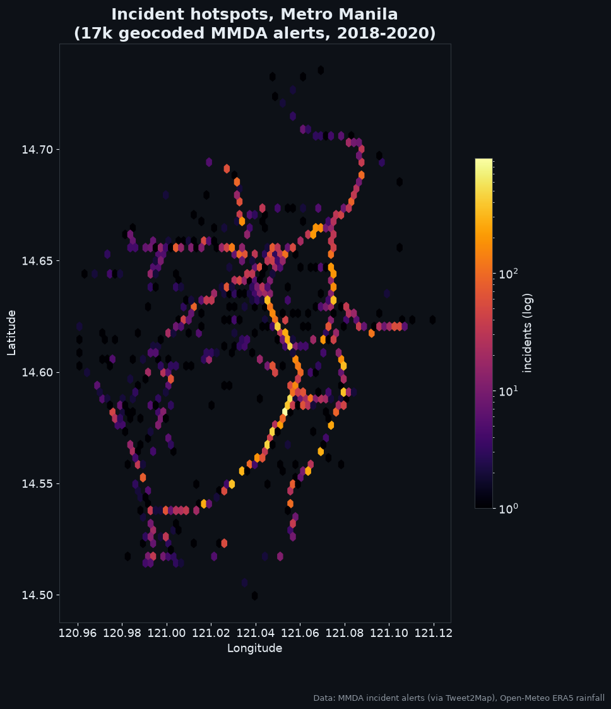
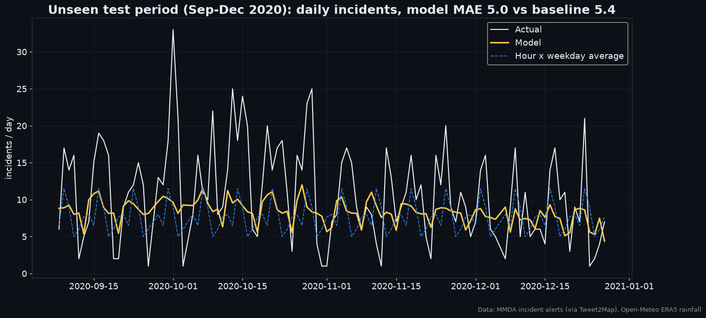
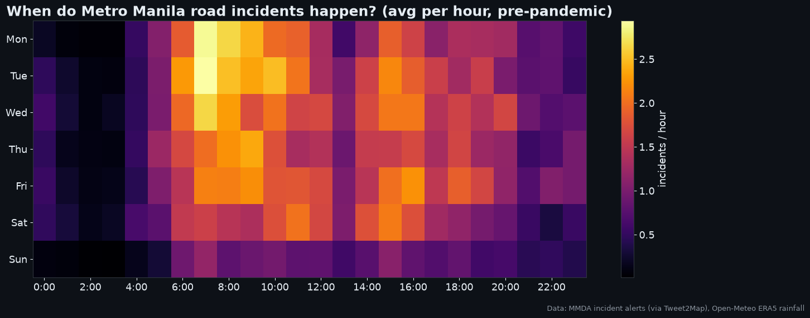
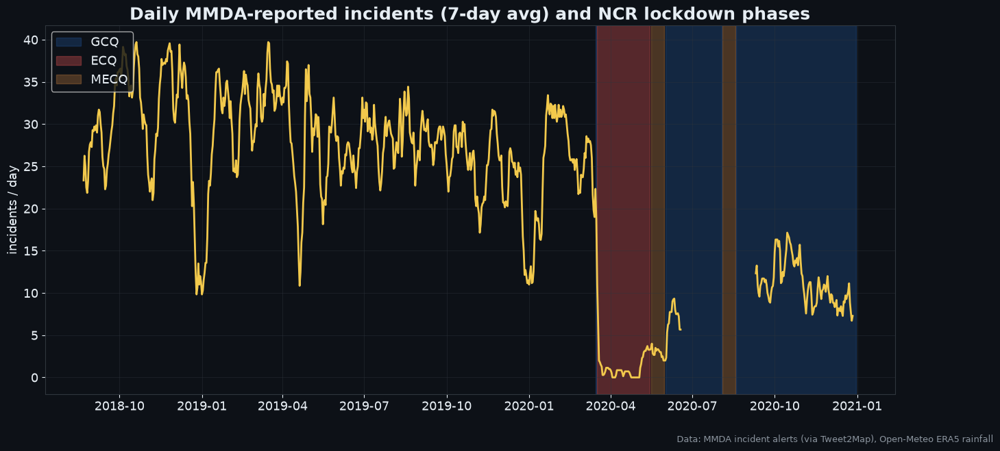
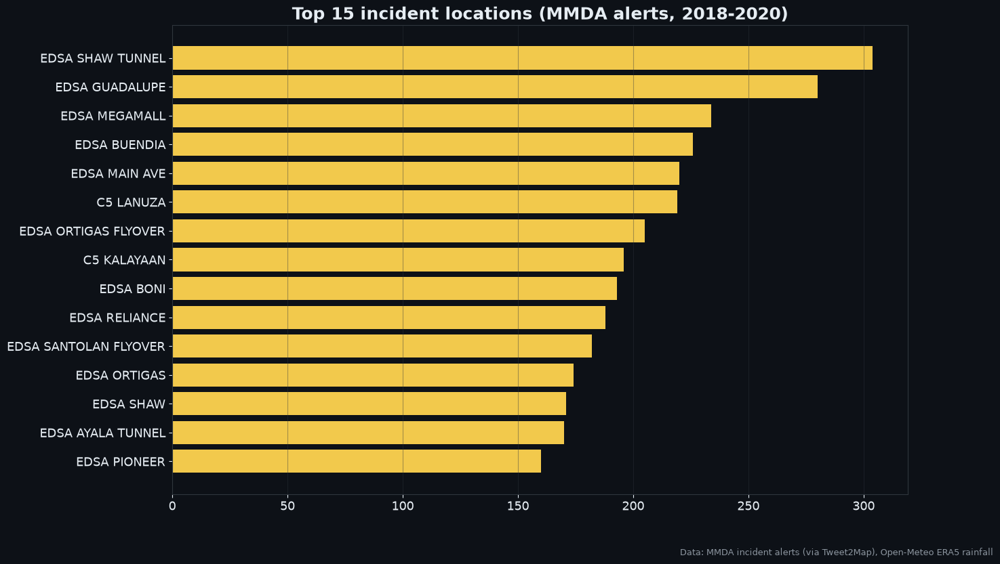
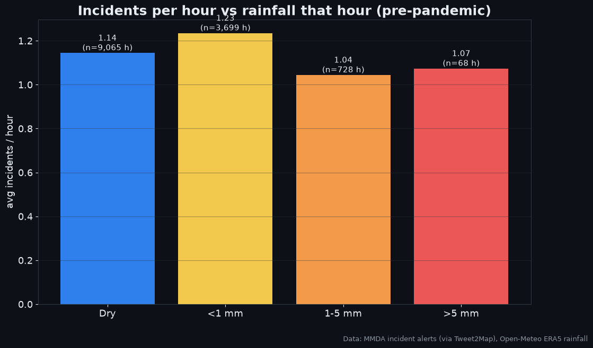
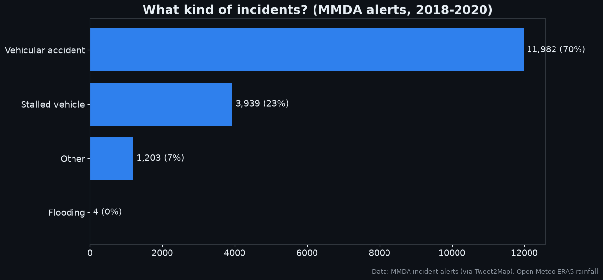
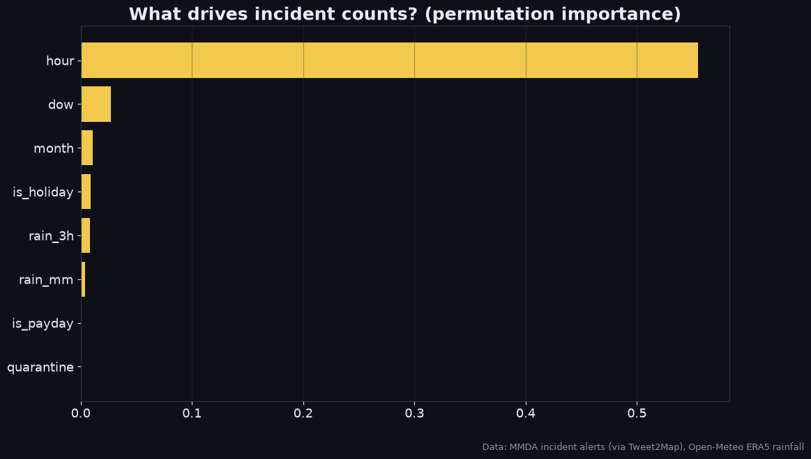

# 🚦 Metro Manila Traffic Incident Forecaster

A machine-learning project built on **100% real data**. It forecasts how many road incidents (accidents, stalled vehicles, flooding) the MMDA will report each hour in Metro Manila, and shows where, when and why they happen.



## Data (all real, all public)

| Dataset | What | Source |
|---|---|---|
| MMDA incident alerts | **17,128** geocoded incidents from Aug 2018 to Dec 2020: time, location, lat/long, type, lanes blocked | @MMDA alerts, parsed by [Tweet2Map](https://github.com/pbrotoisworo/tweet2map) (GPL-3.0) |
| Hourly rainfall, Manila | ERA5 reanalysis precipitation | [Open-Meteo Historical API](https://open-meteo.com/en/docs/historical-weather-api) (CC BY 4.0) |
| Public holidays | Regular and special non-working days | [`holidays`](https://pypi.org/project/holidays/) package (official proclamations) |
| Lockdown phases | NCR ECQ / MECQ / GCQ dates, 2020 | IATF resolutions |

`python run.py` downloads the raw files into `data/raw/`. They are not stored in this repo.

**Known gap:** the Tweet2Map archive is missing roughly mid-June to early September 2020. Any day with zero alerts outside the ECQ is flagged as a gap and excluded from training and evaluation.

## Key findings
- **Rush hours are when incidents happen**, with the morning and evening peaks clearly visible ([heatmap](assets/01_heatmap.png)).
- **EDSA is the hotspot corridor.** The incident map traces EDSA, C5 and Commonwealth almost exactly.
- **COVID ECQ cut reported incidents by about 95%**, from ~28/day to ~1/day. After reopening (GCQ) they settled at ~10–15/day.
- **Light rain increases incidents (+8%/hour), but heavy rain does not.** Fewer cars on the road during downpours likely offsets the more dangerous conditions.
- About **70% of alerts are vehicular accidents**. Stalled vehicles are the next most common type.

## Model
- Gradient boosting with a **Poisson loss** (suited to count data). Features: hour, weekday, month, holiday, payday, quarantine level, rain (this hour and the last 3 hours).
- **Time-based split:** trained on Aug 2018 to Aug 2020, tested on Sep–Dec 2020, which the model never saw.

| Test: Sep–Dec 2020 | Hour × weekday average | **Model** |
|---|---|---|
| Hourly MAE | 0.554 | **0.522** |
| Daily MAE (avg ~11 incidents/day) | 5.37 | **4.96** |



## All visuals
| | |
|---|---|
|  |  |
|  |  |
|  |  |

## Context: Metro Manila traffic today (published figures)
- In the TomTom Traffic Index 2025, a 10 km drive took 31m45s in central Manila, and rush-hour speed averaged 15.2 km/h ([TomTom](https://www.tomtom.com/traffic-index/city/manila/), [Manila Bulletin](https://mb.com.ph/2026/01/22/davao-city-remains-most-traffic-congested-city-in-ph-tomtom-traffic-index)).
- EDSA carried 407,342 vehicles/day in the MMDA AADT 2023 report and ~434k/day at the December 2025 peak ([Top Gear PH](https://www.topgear.com.ph/features/feature-articles/mmda-aadt-report-2023-a2619-20240522), [Manila Bulletin](https://mb.com.ph/2025/12/12/edsa-traffic-hits-holiday-peak-with-434k-vehicles-mmda)).

## 📅 Live dashboard: this week's data
```bash
streamlit run app.py
```
- **This week:** an hourly incident forecast for the current week. It uses **live Open-Meteo rainfall** (observed for the past 7 days, forecast for the next 7) and this year's PH holidays, and lists the riskiest hours.
- **Live speeds:** real current speeds and congestion on EDSA (7 segments), C5, Commonwealth, España and Roxas Blvd, plus a 7-day EDSA speed chart.
- **Hotspot map:** an interactive 3D hexagon map with year, incident-type and hour filters.
- **Patterns:** hourly and daily incident trends.

## 🛰️ Live speed collection (real data, every hour)
`src/collect_tomtom.py` and the GitHub Action in `.github/workflows/collect.yml` record **real TomTom speeds every hour** at 12 points on Metro Manila's main roads. The readings are committed to `live/speeds.csv`, so the repo builds its own up-to-date speed history.

Setup (one time):
1. Get a free API key at [developer.tomtom.com](https://developer.tomtom.com). The free tier allows 2,500 calls/day, and this uses 288.
2. In the repo, go to Settings → Secrets → Actions and add `TOMTOM_API_KEY`.
3. Go to Actions → "Collect live traffic speeds" → Run workflow. After that it runs every hour.

## Run the analysis
```bash
pip install -r requirements.txt
python run.py
```

## Data notes
- The incident model is trained on MMDA alerts from 2018–2020, the full public archive. Forecasts for this week combine that learned pattern with live weather and calendar data.
- Speed data from 2026 onward comes from the live TomTom collector.
- Requesting newer MMDA incident logs through [FOI](https://www.foi.gov.ph/agencies/mmda/) would extend the incident archive.

## Tech
Python · pandas · scikit-learn · matplotlib · Open-Meteo API
